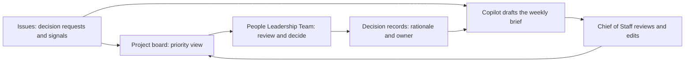

# People Leadership OS

A working example of how a Chief of Staff could run the Office of the Chief People Officer (CPO) on GitHub. Issues are the intake, a project board is the priority view, decision records are the memory, and Copilot drafts the weekly brief from the open issues for a person to review.

I'm Elle Helvig, an HR and talent strategist focused on workforce AI transformation. Over the past 10+ years, I've partnered with business and HR leaders to design scalable programs, modernize talent and performance practices, lead complex change initiatives, and strengthen workforce capability. I built this to show how I'd run the Office of the CPO as Chief of Staff, with Copilot drafting and a person making the call.

Harbor is a fictional 4,000-person developer-tools company inside a larger parent, Meridian Group. That setup drives most of the hard calls here, like when to adopt the parent's programs. Every person, issue, date, and number is invented.

**Start here:** read the [weekly brief](briefs/2026-w46-cpo-brief.md), then open any issue it cites to check the claim against its source. Its bottom line:

> Two decisions need you this week. Both unblock other work. Six issues do not need your time.

Every line in the brief cites the issue it came from.

For how I would set this up in a new role, see [the first 90 days](docs/first-90-days.md).

## How the weekly loop works

1. Anyone on the People Leadership Team opens an issue with one of two forms: a [decision request](.github/ISSUE_TEMPLATE/decision-request.yml) or a [signal](.github/ISSUE_TEMPLATE/signal.yml).
2. Open issues land on the [project board](https://github.com/users/ellehelvig/projects/2).
3. Each week, Copilot drafts the brief from the open issues using the rules in [copilot-instructions.md](.github/copilot-instructions.md). Every claim cites its source issue, and issues with no owner are flagged.
4. The Chief of Staff edits the draft before it goes to the CPO.
5. Decisions that are material or hard to reverse get a decision record.

## Checks on every brief

The brief is only useful if the CPO can trust it. A [GitHub Action](.github/workflows/brief-check.yml) checks the latest brief against the live issues and writes the result to the run summary. It runs when a brief changes, when an issue is opened, edited, closed or reopened, and every Monday morning before the leadership meeting.

It checks three rules from [copilot-instructions.md](.github/copilot-instructions.md):

- Every line in the brief cites an issue.
- Every cited issue still exists and is open. A closed issue means the line is stale.
- Every open issue with no owner is named in the owner-gap note.

It also lists open issues the brief leaves out, as a prompt rather than a failure. It cannot tell whether a line is a fair reading of its issue. The Chief of Staff still does that.

To run it yourself: `python scripts/check_brief.py --issues-json tests/fixtures/issues-2026-w46.json`. The tests are in [tests/](tests/) and use only the Python standard library.

## What is in here

| Path | What it is |
|---|---|
| [Issues](../../issues) | Twelve open issues: five decision requests and seven signals |
| [briefs/2026-w46-cpo-brief.md](briefs/2026-w46-cpo-brief.md) | The weekly brief: Copilot's draft from those issues, edited down to one page |
| [docs/operating-rhythm.md](docs/operating-rhythm.md) | Weekly, monthly, and quarterly cadence, with who decides what |
| [docs/align-or-diverge.md](docs/align-or-diverge.md) | Five tests for when a subsidiary adopts the parent company's People programs |
| [docs/first-90-days.md](docs/first-90-days.md) | How I would spend the first 90 days as Chief of Staff to the CPO, and how we would know it was working |
| [decisions/0001-ai-enabled-people-operating-model.md](decisions/0001-ai-enabled-people-operating-model.md) | A sample decision record |
| [scripts/check_brief.py](scripts/check_brief.py) | The brief check, with [tests](tests/) and a saved snapshot of the issues |

## What this does not do

- It does not make decisions or replace the CPO's judgment.
- It does not authorize putting employee data into an AI tool.
- It does not describe any real company's process.

## How this was built

- **Elle Helvig** chose the problem, directed the work, supplied the reference reading behind the framework, and approves what is published here.
- **GitHub Copilot** drafted the first version of each document and both issue forms, and wrote the weekly brief from the open issues in this repository.
- **Claude** helped shape the concept, ran checks on the files, created the issues and board from Copilot's sample data, and drafted the edits to the brief, the align-or-diverge framework, and the decision record. Claude also wrote the brief check and its tests.

## Author

[Elle Helvig](https://github.com/ellehelvig)

Licensed under the [MIT License](LICENSE).
