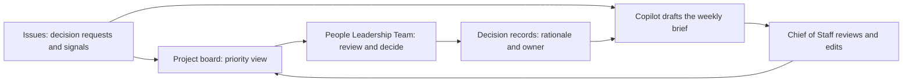

# People Leadership OS

A working example of how a Chief of Staff could run the Office of the Chief People Officer (CPO) on GitHub. Issues are the intake, a project board is the priority view, decision records are the memory, and Copilot drafts the weekly brief from the open issues for a person to review.

Harbor is a fictional 4,000-person developer-tools company inside a larger parent, Meridian Group. That setup drives most of the hard calls here, like when to adopt the parent's programs. Every person, issue, date, and number is invented.

**Start here:** read the [weekly brief](briefs/2026-w46-cpo-brief.md), then open any issue it cites to check the claim against its source. Its bottom line:

> Two decisions need you this week. Both unblock other work. Six issues do not need your time.

Every line in the brief cites the issue it came from.

## How the weekly loop works

1. Anyone on the People Leadership Team opens an issue with one of two forms: a [decision request](.github/ISSUE_TEMPLATE/decision-request.yml) or a [signal](.github/ISSUE_TEMPLATE/signal.yml).
2. Open issues land on the [project board](https://github.com/users/ellehelvig/projects/2).
3. Each week, Copilot drafts the brief from the open issues using the rules in [copilot-instructions.md](.github/copilot-instructions.md). Every claim cites its source issue, and issues with no owner are flagged.
4. The Chief of Staff edits the draft before it goes to the CPO.
5. Decisions that are material or hard to reverse get a decision record.

## What is in here

| Path | What it is |
|---|---|
| [Issues](../../issues) | Twelve open issues: five decision requests and seven signals |
| [briefs/2026-w46-cpo-brief.md](briefs/2026-w46-cpo-brief.md) | The weekly brief: Copilot's draft from those issues, edited down to one page |
| [docs/operating-rhythm.md](docs/operating-rhythm.md) | Weekly, monthly, and quarterly cadence, with who decides what |
| [docs/align-or-diverge.md](docs/align-or-diverge.md) | Five tests for when a subsidiary adopts the parent company's People programs |
| [decisions/0001-ai-enabled-people-operating-model.md](decisions/0001-ai-enabled-people-operating-model.md) | A sample decision record |

## What this does not do

- It does not make decisions or replace the CPO's judgment.
- It does not authorize putting employee data into an AI tool.
- It does not describe any real company's process.

## How this was built

- **Elle Helvig** chose the problem, directed the work, supplied the reference reading behind the framework, and approves what is published here.
- **GitHub Copilot** drafted the first version of each document and both issue forms, and wrote the weekly brief from the open issues in this repository.
- **Claude** helped shape the concept, ran checks on the files, created the issues and board from Copilot's sample data, and drafted the edits to the brief, the align-or-diverge framework, and the decision record.

## Author

[Elle Helvig](https://github.com/ellehelvig)

Licensed under the [MIT License](LICENSE).
