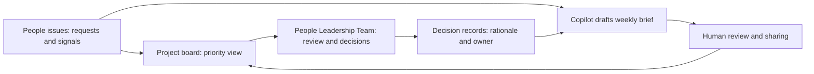

# People Leadership OS

This is a fictional example of how Harbor could run the Office of the Chief People Officer (CPO) using GitHub. It is for a Chief of Staff to the CPO, the People Leadership Team, and partners who need a clear view of decisions and risks. It turns issues into priorities, decisions into durable records, and the week's open work into a short brief.

## Who it is for

Harbor is a fictional, 4,000-person developer-tools subsidiary of fictional Meridian Group. This example is for leaders who need to coordinate People work across a subsidiary and its parent company without losing sight of Harbor's needs.

## How the weekly loop works

People issues capture requests and signals. The Project board shows what needs attention. Decision records preserve what was decided and why. Copilot can use open issues to draft a weekly brief, which a person checks before sharing.

## What this does not do

- It does not make decisions or replace the CPO's judgment.
- It does not treat an issue, score, or example as evidence about a real organization.
- It does not authorize the use of employee data in an AI tool.
- It does not replace Harbor's own review of its needs, controls, or employee communications.

All content in this repository is fictional. Dates, issue identifiers, counts, scores, and other numbers are illustrative.
